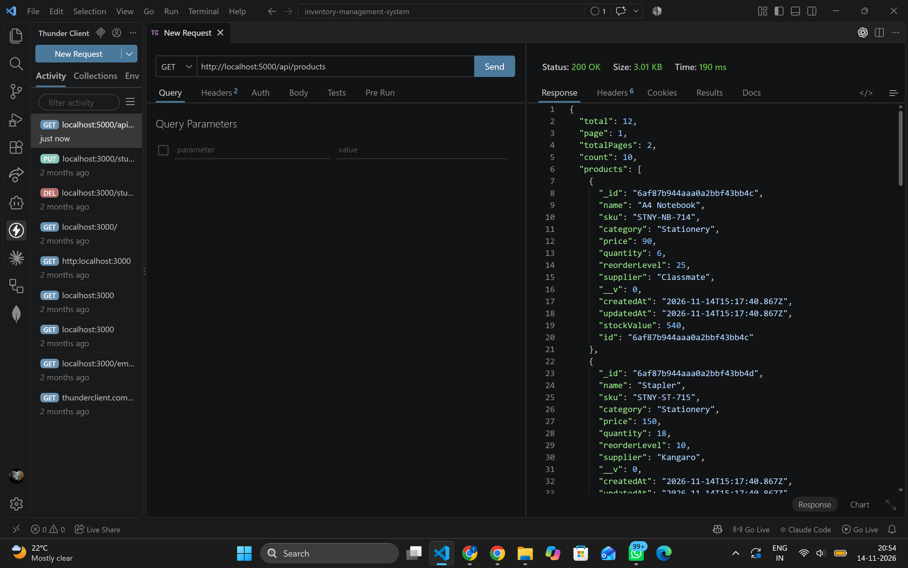
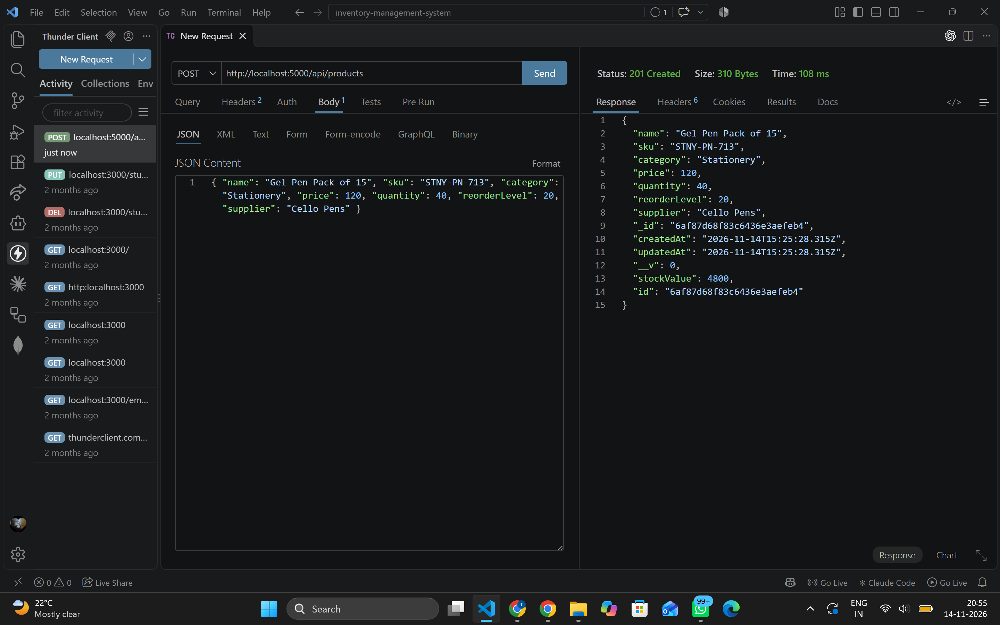
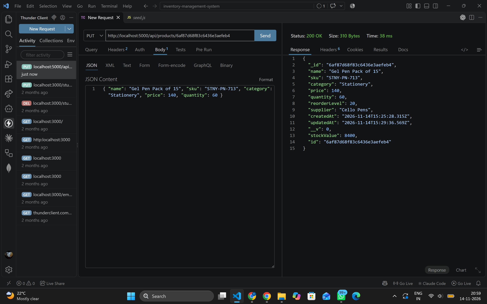
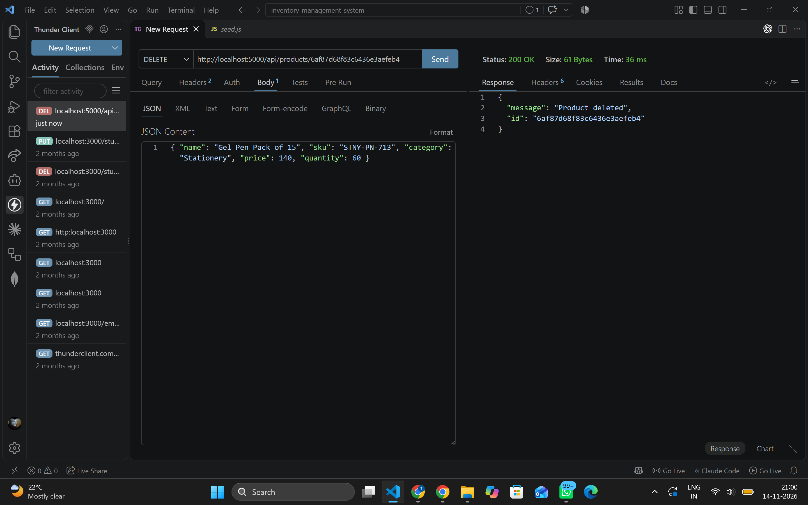
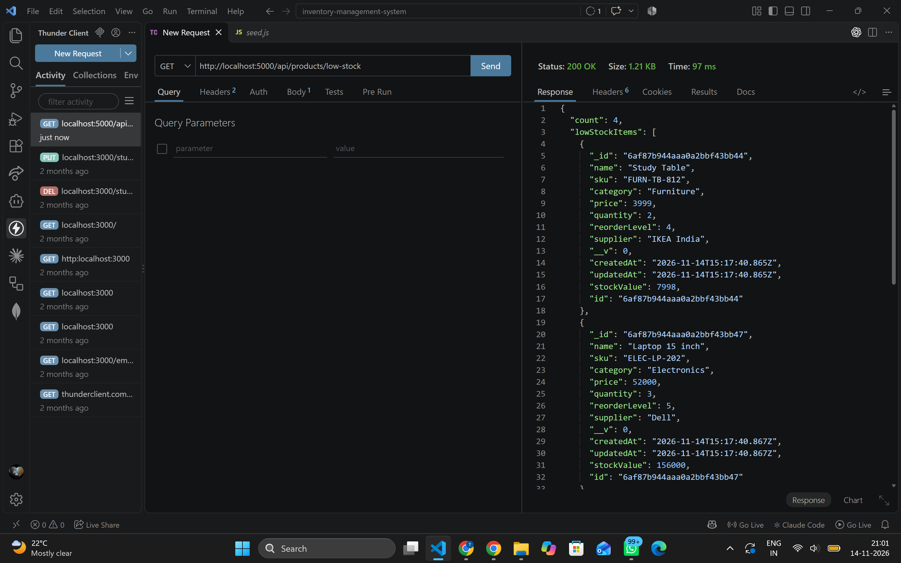
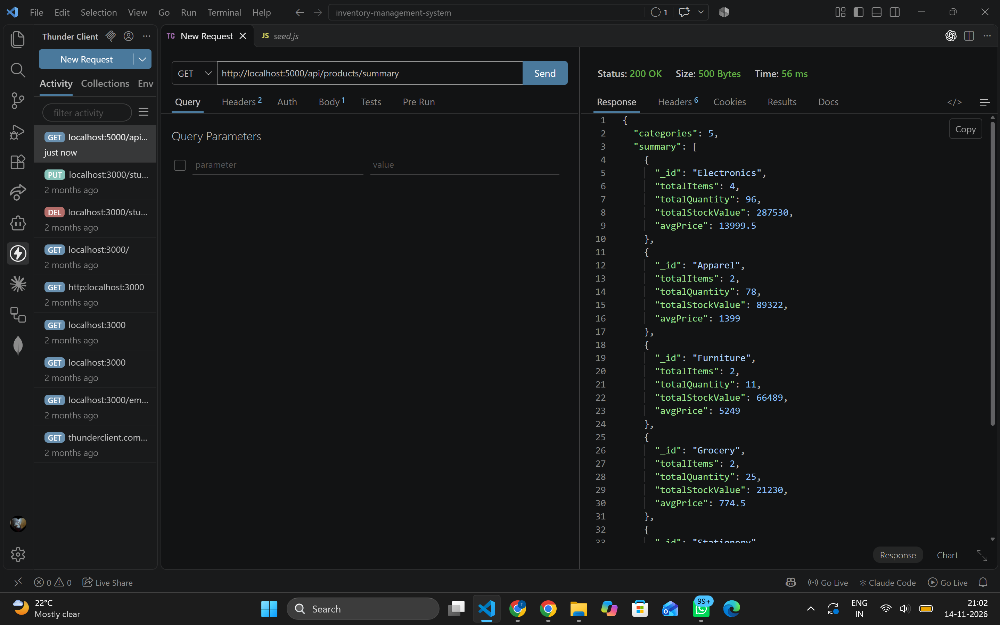
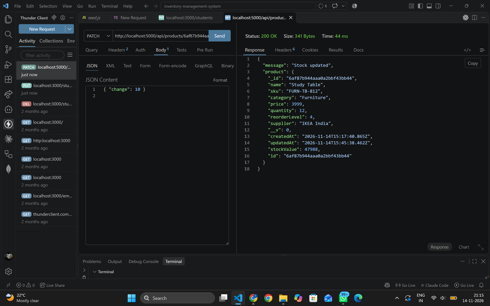

# 📦 Inventory Management REST API
### Assignment 3 | Backend Development

A backend application designed to maintain and manage product inventory with the help of RESTful APIs. It provides product operations, stock control, advanced data queries and inventory summaries.

---

## 🎯 Project Objective

The main objective of this assignment is to develop a product inventory system using Node.js, Express.js and MongoDB. The application allows users to manage product information and monitor available stock through API endpoints.

## 🛠️ Development Stack

| Technology | Purpose |
|---|---|
| Node.js | JavaScript runtime |
| Express.js | Backend framework |
| MongoDB | Database |
| Mongoose | Schema and database management |
| dotenv | Environment configuration |
| Postman | API testing |

---

## ⚙️ Getting Started

Follow these instructions to run the application locally.

**1. Install project dependencies**

```bash
npm install
```

**2. Configure environment variables**

Create a `.env` file in the project directory:

```env
PORT=5000
MONGO_URI=your_mongodb_connection_string
```

**3. Start MongoDB**

Make sure your MongoDB service is running and the connection string is configured correctly.

**4. Launch the application**

```bash
node server.js
```

**5. Access the API**

```text
http://localhost:5000/api/products
```

Use Postman or Thunder Client to send API requests.

---

## 🚀 Implemented Modules

### 1. Product Operations

- Add new products to the database.
- Retrieve the complete product list.
- Find individual products using their ID.
- Modify existing product information.
- Remove products from the catalogue.

### 2. Inventory Control

- Increase available stock.
- Decrease available stock.
- Perform stock updates using MongoDB `$inc` operations.
- Maintain inventory quantities safely.

### 3. Data Query System

The API supports additional query capabilities:

- Category-based filtering
- Product search
- Minimum and maximum price filtering
- Price-based sorting
- Page-wise data retrieval
- Custom result limits

### 4. Inventory Analytics

MongoDB aggregation is used to generate:

- Low-stock product reports
- Category-wise inventory summaries

### 5. Validation and Error Management

- Required field validation
- Unique SKU constraint
- Enum and minimum value validation
- Invalid ID detection
- Duplicate SKU handling
- Centralized error responses

---

## 📸 Application Output

The following screenshots demonstrate the API execution and testing process.

### Product API – Output 01



### Product API – Output 02



### Database and API – Output 03



### Request and Response – Output 04



### Inventory Operations – Output 05



### Stock Update – Output 06



### Final API Result – Output 07



---

## 📁 Main Project Components

| File | Description |
|---|---|
| `server.js` | Application entry point |
| `db.js` | Database connection |
| `Product.js` | Product schema |
| `productController.js` | Product operations |
| `productRoutes.js` | API route definitions |
| `errorHandler.js` | Error management |
| `seed.js` | Initial data seeding |

---

## 📌 Final Remarks

This assignment provided practical experience in backend application development, database integration and REST API implementation.

The completed system combines product management, inventory updates, query operations and aggregation-based reporting into a single backend application.

**Assignment 3 – Inventory and Data Management System**
